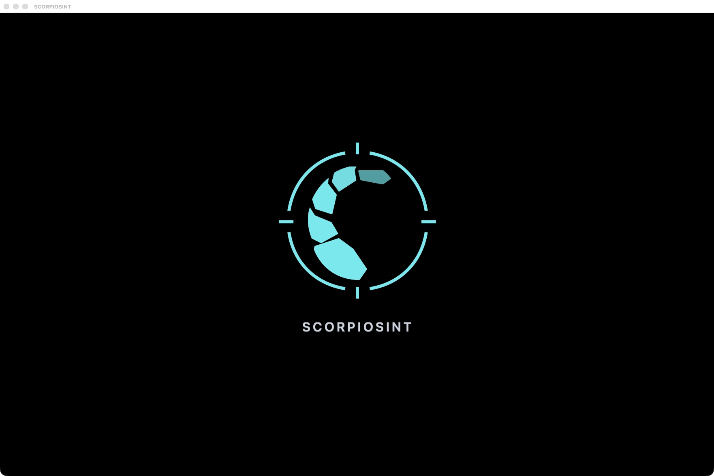
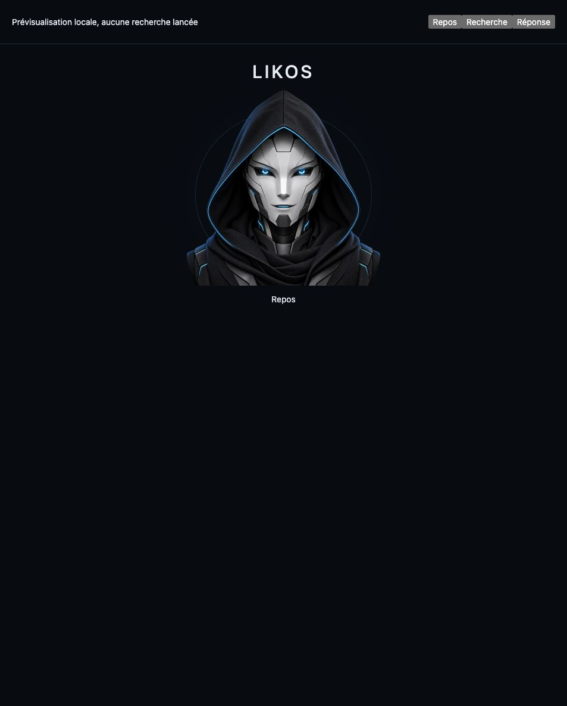
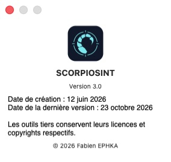

# SCORPIOSINT

**Version 3.0** · **Projet créé le 12 juin 2026** · **Fabien EPHKA**

SCORPIOSINT est un atelier OSINT pour macOS. Il rassemble des outils de recherche en sources ouvertes dans une seule interface, avec un historique d’enquête et des liens vers les sources à vérifier.

## Pourquoi j’ai créé SCORPIOSINT

J’ai voulu pouvoir suivre une piste de bout en bout sans passer mon temps à changer d’outil, à jongler entre les onglets ou à recopier les mêmes recherches. L’idée est de partir d’un indice, de croiser plusieurs sources et de retrouver le fil de l’enquête quand j’y reviens plus tard.

## À quoi ça sert

- Examiner un domaine ou un site, retrouver des traces publiques et consulter des archives web.
- Recouper un pseudonyme, un profil ou une mention publique en remontant aux sources.
- Examiner une image ou un indice de localisation, puis consigner les résultats et leurs limites.

## LIKOS, Tor et portabilité

**LIKOS** est l’assistant d’enquête local de SCORPIOSINT. Il aide à choisir les recherches, à reprendre les éléments déjà collectés et à synthétiser les résultats avec des sources cliquables. J’assume une orientation non censurée dans le choix de l’assistant local. Les conclusions restent à vérifier à partir des sources et des éléments recueillis.

**Tor** est intégré pour les recherches et consultations qui passent par les parcours prévus à cet effet. Le choix d’un assistant local et l’intégration de Tor font partie de la place que je veux donner à l’autonomie de l’utilisateur dans son enquête.

SCORPIOSINT est conçu comme une **application portable pour macOS**. Le dossier de l’application et celui de ses données peuvent être emportés ensemble sur une clé USB, un SSD externe ou un autre support, pour les utiliser sur un Mac compatible.

## Prochaines évolutions

- **Extension Chrome dédiée**, inspirée de celle créée pour mon autre outil, **LAZYFAB**. LIKOS pourra lancer des recherches sur des sites externes en arrière-plan dans des onglets réservés à SCORPIOSINT, puis restituer les résultats et leurs liens sans interrompre ma navigation personnelle. Cette intégration est prévue.
- **Dossiers d’enquête**, avec un meilleur suivi des pistes, le rapprochement des résultats qui se recoupent et des exports sourcés.
- **Collecte et portabilité**, avec des recherches mieux enchaînées, des retours plus clairs quand une source est indisponible et davantage de vérifications sur support externe.

## Aperçus

| Démarrage | LIKOS, aperçu au repos |
| --- | --- |
|  |  |

## Statut du projet

SCORPIOSINT est actuellement un projet personnel, privé et propriétaire, en cours de développement. Ce dépôt sert de vitrine et contient la présentation du projet et des captures de l’interface. À terme, mon objectif est de mettre SCORPIOSINT à la disposition de tous. Le code source, l’application et les composants ne sont pas distribués à ce stade.

© 2026 Fabien EPHKA. Les composants tiers conservent leurs licences respectives.
