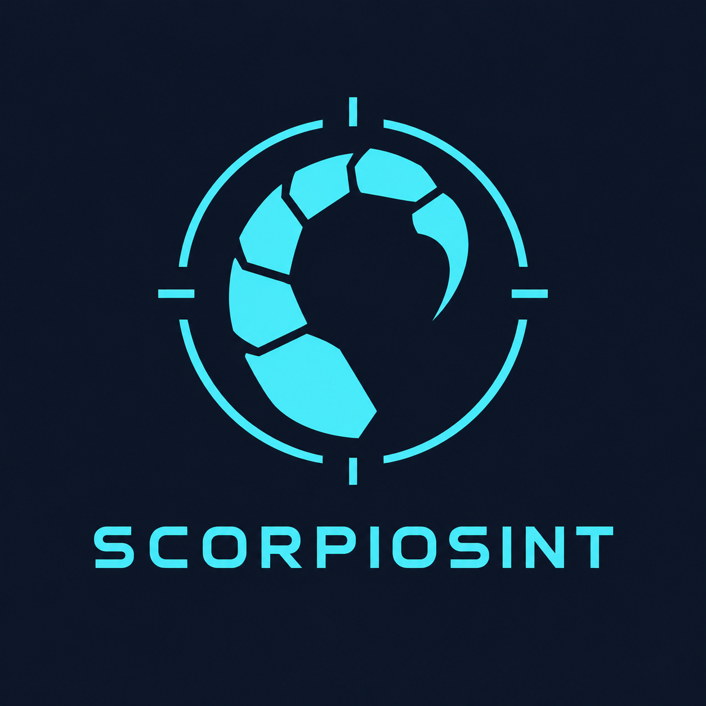
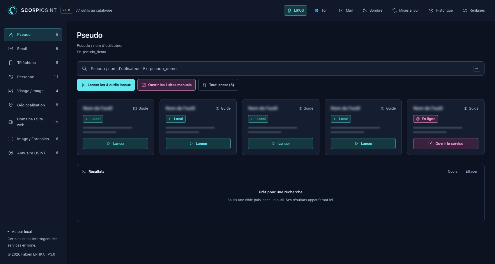
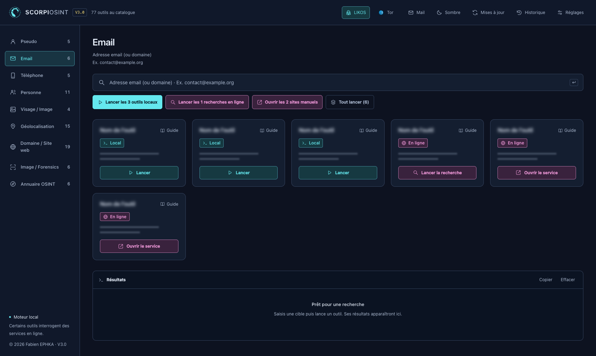
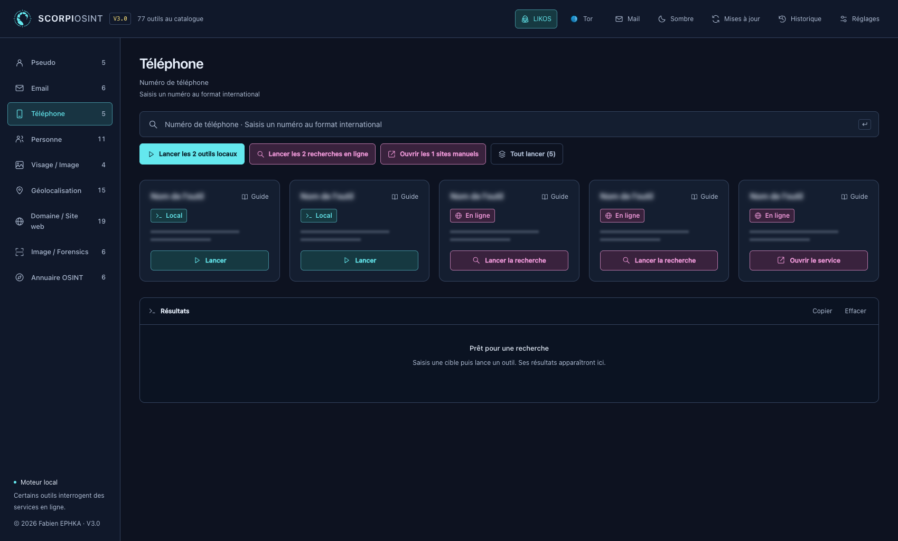
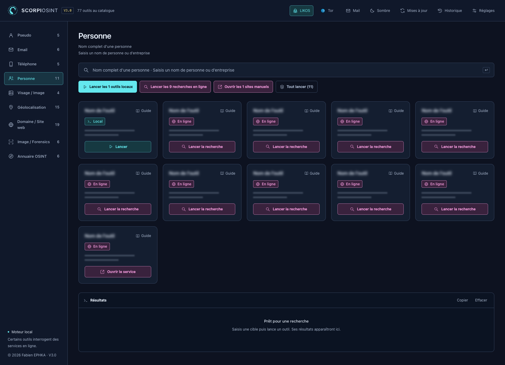
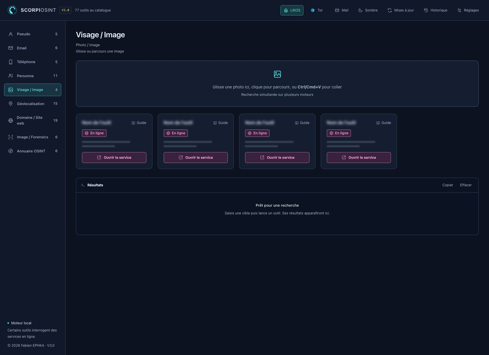
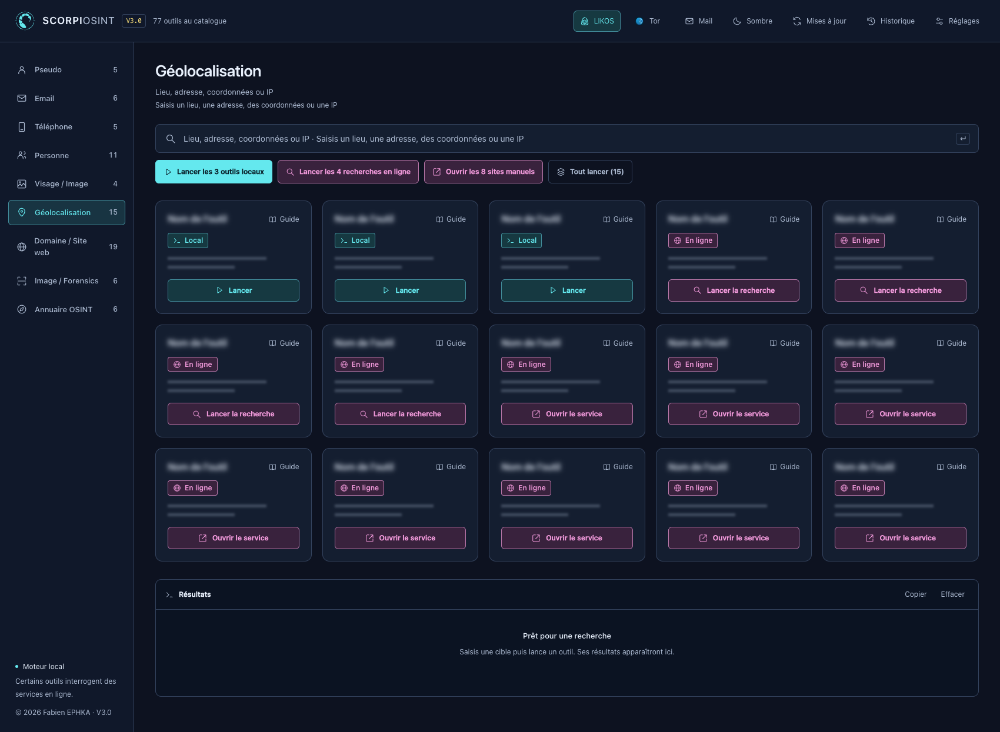
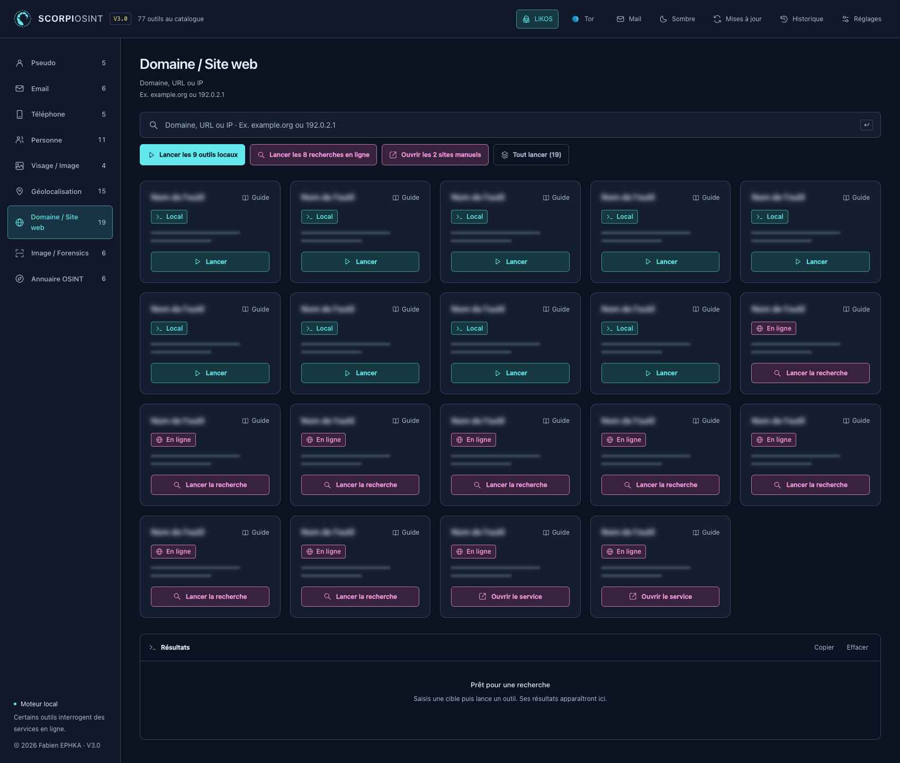
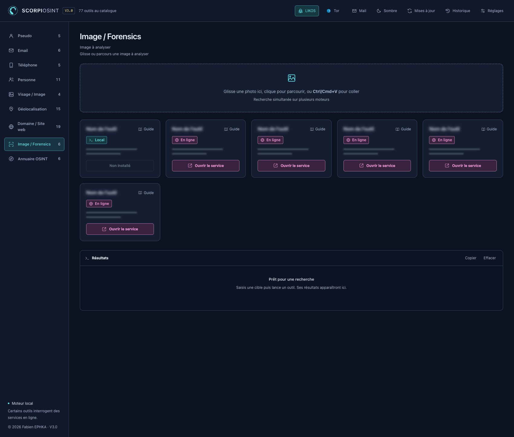
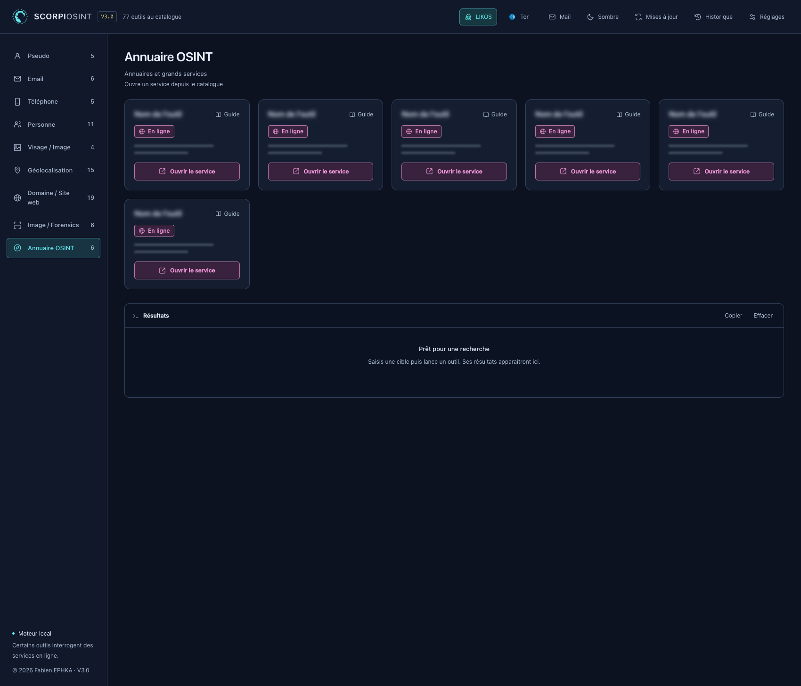

  

<h1 align="center">SCORPIOSINT · Application OSINT portable pour macOS</h1>

**Version 3.0** · **Projet créé le 12 juin 2026** · **Fabien EPHKA**

SCORPIOSINT est une application OSINT portable pour macOS dédiée à la recherche en sources ouvertes (Open Source Intelligence). Elle réunit 77 outils locaux et services en ligne, un historique d’enquête et des liens vers les sources. LIKOS assiste les recherches en local et Tor est intégré pour les consultations qui passent par ce réseau.

**Un portage Windows est prévu.**

## Pourquoi j’ai créé SCORPIOSINT

J’ai voulu pouvoir suivre une piste de bout en bout sans passer mon temps à changer d’outil, à jongler entre les onglets ou à recopier les mêmes recherches. L’idée est de partir d’un indice, de croiser plusieurs sources et de retrouver le fil de l’enquête quand j’y reviens plus tard.

## À quoi ça sert

- Examiner un domaine ou un site, retrouver des traces publiques et consulter des archives web.
- Recouper un pseudonyme, un profil ou une mention publique en remontant aux sources.
- Examiner une image ou un indice de localisation, puis consigner les résultats et leurs limites.

## LIKOS, Tor et portabilité

**LIKOS** est l’assistant d’enquête local de SCORPIOSINT. Il aide à choisir les recherches, à reprendre les éléments déjà collectés et à synthétiser les résultats avec des sources cliquables. J’assume une orientation non censurée dans le choix de l’assistant local. Les conclusions restent à vérifier à partir des sources et des éléments recueillis.

**Tor** est intégré à SCORPIOSINT pour renforcer l’anonymat et la sécurité des consultations qui passent par ce réseau. Il masque l’adresse IP d’origine aux sites consultés via Tor. L’intégration facilite aussi l’accès rapide aux services `.onion` du dark web lorsqu’une enquête le nécessite.

SCORPIOSINT est conçu comme une **application portable pour macOS**. Le dossier de l’application et celui de ses données peuvent être emportés ensemble sur une clé USB, un SSD externe ou un autre support, pour les utiliser sur un Mac compatible.

## Prochaines évolutions

- **Extension Chrome dédiée**, inspirée de celle créée pour mon autre outil, **[LazyBrady](https://github.com/FabienEphKa/LazyBrady)**. LIKOS pourra lancer des recherches sur des sites externes en arrière-plan dans des onglets réservés à SCORPIOSINT, puis restituer les résultats et leurs liens sans interrompre ma navigation personnelle. Cette intégration est prévue.
- **Dossiers d’enquête**, avec un meilleur suivi des pistes, le rapprochement des résultats qui se recoupent et des exports sourcés.
- **Collecte et portabilité**, avec des recherches mieux enchaînées, des retours plus clairs quand une source est indisponible et davantage de vérifications sur support externe.

## Accueil et catalogue

Le menu de gauche donne accès aux **77 entrées** réparties en **neuf catégories**. Les badges distinguent les outils **locaux** des services **en ligne**. Ces captures reprennent la répartition du catalogue. Les noms et détails des outils sont masqués et les champs montrent des exemples neutres.

| Catégories du catalogue | |
| --- | --- |
| **Email**  | **Téléphone**  |
| **Personne**  | **Visage / Image**  |
| **Géolocalisation**  | **Domaine / Site web**  |
| **Image / Forensics**  | **Annuaire OSINT**  |

## Aperçus

| Démarrage | LIKOS, aperçu au repos |
| --- | --- |
|  |  |

## Statut du projet

SCORPIOSINT est un projet personnel et propriétaire en cours de développement. Cette vitrine publique présente l’application et son interface. Mon objectif est de mettre l’application à la disposition de tous à terme. Le code source, l’application et les composants ne sont pas distribués à ce stade.

© 2026 Fabien EPHKA. Les composants tiers conservent leurs licences respectives.
